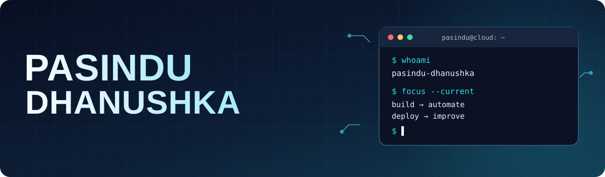
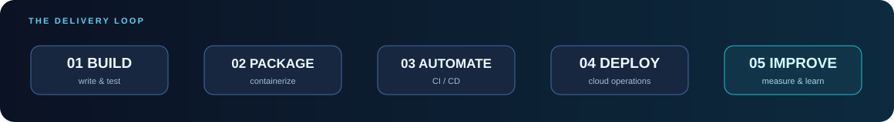
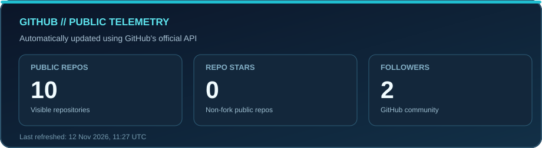
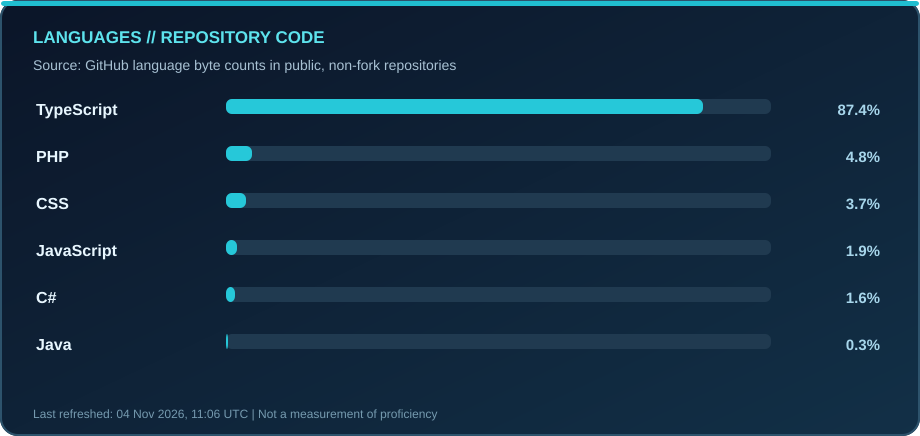

 

  

---

## About Me

I'm **Pasindu Dhanushka Ranasinghe**, an **Information Systems undergraduate at the University of Colombo School of Computing (UCSC)**, Sri Lanka.

I'm interested in the space where **software development meets infrastructure**. I enjoy developing applications, understanding the systems they run on, and learning how to make software delivery more reliable through containers, automation, and cloud technology.

## Tech Stack

| Area | Tools & topics |
|:--|:--|
| **Cloud & infrastructure** | AWS fundamentals, Linux, networking |
| **DevOps & delivery** | Docker, Git, GitHub, CI/CD concepts |
| **Software development** | JavaScript, TypeScript, Next.js, NestJS, Node.js |
| **Engineering interests** | Automation, troubleshooting, maintainability, collaboration |

## Delivery Pipeline

> The cycle I'm learning to put into practice: **build → package → automate → deploy → improve**.

## Featured Projects

<table>
<tr>
<td width="50%" valign="top">
<h3><a href="https://github.com/Pasindu-Dhanushka/NexBus">🚌 NexBus</a></h3>

A smart bus tracking and management system with timetable management, transport operations and role-based dashboards.

<code>PHP</code> <code>JavaScript</code> <code>MySQL</code> <code>MVC</code>

</td>
<td width="50%" valign="top">
<h3><a href="https://github.com/Pasindu-Dhanushka/AI-Driven-Skill-to-Career-Pathway-Predictor">🧠 AI Career Pathway Predictor</a></h3>

A prototype connecting students' skills and interests to career pathways, skill gaps and learning roadmaps, with Sri Lanka-focused context.

<code>MERN</code> <code>Career matching</code>

</td>
</tr>
<tr>
<td width="50%" valign="top">
<h3><a href="https://github.com/Pasindu-Dhanushka/myflows">🔀 myflows / BizFlows</a></h3>

An exploratory workflow automation project exploring configuration-driven flows and a planned visual flow designer.

<code>Workflow design</code> <code>JSON / YAML</code>

</td>
<td width="50%" valign="top">
<h3><a href="https://github.com/Pasindu-Dhanushka/ci-cd-tutorial-sample-app">⚙️ CI/CD Learning Lab</a></h3>

A sample Flask application for studying automated testing, containerization and GitHub Actions workflows.

<code>Python</code> <code>Flask</code> <code>Docker</code> <code>GitHub Actions</code>

</td>
</tr>
</table>

## GitHub Statistics

  
   
  

These SVG cards are generated from GitHub's official API and stored in this repository. GitHub Actions refreshes them daily. Language distribution measures source code bytes, not proficiency.

## Contribution Snake

  <picture>
    <source media="(prefers-color-scheme: dark)" srcset="https://raw.githubusercontent.com/Pasindu-Dhanushka/Pasindu-Dhanushka/output/github-contribution-grid-snake-dark.svg">
    <source media="(prefers-color-scheme: light)" srcset="https://raw.githubusercontent.com/Pasindu-Dhanushka/Pasindu-Dhanushka/output/github-contribution-grid-snake.svg">
    
  </picture>

Generated daily by GitHub Actions and published from the `output` branch.

## Current Focus

- ☁️ **Cloud:** AWS fundamentals, infrastructure and networking.
- 🐧 **Linux & containers:** systems administration, Docker and practical troubleshooting.
- 🔁 **Delivery:** CI/CD concepts and reproducible deployment workflows.
- 💻 **Backend:** APIs, maintainable application architecture and teamwork.

## Recent Activity

<!--START_SECTION:activity-->
1. 🎉 Merged PR [#3](https://github.com/Pasindu-Dhanushka/paytrack/pull/3) in [Pasindu-Dhanushka/paytrack](https://github.com/Pasindu-Dhanushka/paytrack)
2. 💪 Opened PR [#3](https://github.com/Pasindu-Dhanushka/paytrack/pull/3) in [Pasindu-Dhanushka/paytrack](https://github.com/Pasindu-Dhanushka/paytrack)
3. 🎉 Merged PR [#2](https://github.com/Pasindu-Dhanushka/paytrack/pull/2) in [Pasindu-Dhanushka/paytrack](https://github.com/Pasindu-Dhanushka/paytrack)
4. 💪 Opened PR [#2](https://github.com/Pasindu-Dhanushka/paytrack/pull/2) in [Pasindu-Dhanushka/paytrack](https://github.com/Pasindu-Dhanushka/paytrack)
5. 🎉 Merged PR [#1](https://github.com/Pasindu-Dhanushka/paytrack/pull/1) in [Pasindu-Dhanushka/paytrack](https://github.com/Pasindu-Dhanushka/paytrack)
6. 💪 Opened PR [#1](https://github.com/Pasindu-Dhanushka/paytrack/pull/1) in [Pasindu-Dhanushka/paytrack](https://github.com/Pasindu-Dhanushka/paytrack)
<!--END_SECTION:activity-->

Populated automatically by the GitHub Activity workflow when supported public activity is available.

## Connect

  
<em>Curious about the entire journey — from the first line of code to the running system.</em>

